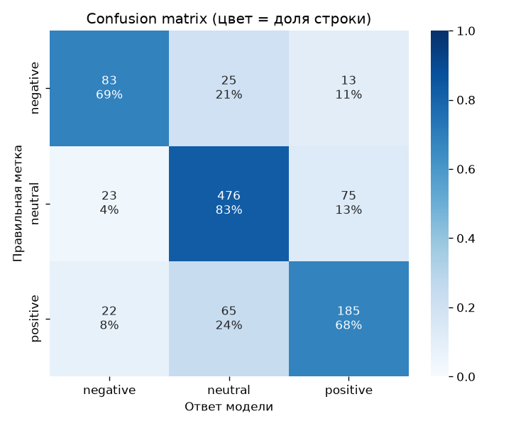

# Financial News Sentiment Classifier

Classifies English financial news sentences as **negative / neutral / positive**.
Full ML workflow: data -> preprocessing -> baseline -> improvements -> error analysis -> inference.

## Results

Test set: 967 sentences (stratified 20% split, `random_state=42`). Main metric: **macro F1**
(classes are imbalanced: neutral 59%, positive 28%, negative 12.5%).

| Model | Macro F1 | Accuracy | Negative recall |
|---|---|---|---|
| Dummy (always neutral) | 0.248 | 0.594 | 0.000 |
| Baseline: TF-IDF + LogReg | 0.693 | 0.776 | 0.438 |
| **Best: TF-IDF + LogReg, C=3, class_weight="balanced"** | **0.727** | 0.769 | **0.686** |

Model selection was done by 5-fold cross-validation on the train set only (CV macro F1 0.652 -> 0.721).
The test set was used once, for the final model.

## Quickstart

Tested on Python 3.14, macOS.

```bash
python3.14 -m venv .venv && source .venv/bin/activate
pip install -r requirements.txt
pip install -e .          # required: the saved model references the package's preprocessing
make all                  # download data -> clean -> train -> error analysis -> demo
make test                 # 26 tests
```

Predict:

```bash
python -m finnews_sentiment.models.predict --text "Net profit fell 30 % in the third quarter ."
python -m finnews_sentiment.models.predict --input examples/new_news.csv --output reports/predictions.csv
```

```json
[
  {
    "text": "Net profit fell 30 % in the third quarter .",
    "label": "negative",
    "confidence": 0.945,
    "probabilities": {"negative": 0.945, "neutral": 0.029, "positive": 0.026},
    "unknown_words": []
  }
]
```

`unknown_words` lists words the model has never seen (zero weight). Treat a prediction with low
`confidence` (< ~0.7) or non-empty `unknown_words` as unreliable. Format details: [reports/day06_inference.md](reports/day06_inference.md).

## Data

[Financial PhraseBank v1.0](https://huggingface.co/datasets/takala/financial_phrasebank), file
`Sentences_50Agree` (label agreed by at least 50% of annotators): 4846 sentences.
Downloaded as a zip directly (the HF loading script is not supported by recent `datasets`).
After cleaning: 4835 (removed 6 duplicates, 2 pairs of identical texts with conflicting labels, 1 junk line).
License: CC BY-NC-SA 3.0.

## Pipeline

```
raw txt (text@label, latin-1)
  -> load_data.py      parse to CSV                      data/interim/
  -> preprocess.py     clean rows, encode labels         data/processed/clean_news.csv
  -> train_model.py    baseline                          models/baseline_logreg.joblib
  -> train_improved.py 6 experiments by CV, best -> test models/best_model.joblib
  -> error_analysis.py confusion matrix, top words, confident errors
  -> predict.py        inference: text or CSV
```

Text cleaning (`preprocess_text`) lives **inside** the sklearn Pipeline, so training and inference
always use the same preprocessing.

## Key decisions

- **No stop-word removal.** The course template removed NLTK stop words, digits and short words. That turned
  "profit went **down**" and "profit went **up**" into the same string and dropped "no" from "no plans to cut jobs".
  The trained model confirms it: `down` is the strongest negative feature, `up` / `up from` are top positive ones.
- **class_weight="balanced"** gave most of the gain: the baseline hid in "neutral" (negative recall 0.44).
- **Tuning C**: the baseline was over-regularized (C=1 -> 0.652, C=10 -> 0.697 in CV without class weights).
- Did not help: single-character tokens and `%`, trigrams (within CV noise).

Details: [day 4 report](reports/day04_improvements.md).

## Error analysis



- 63% of errors are on the neutral / positive border; 16% are opposite-polarity errors (negative <-> positive).
- Typical failures: direction without object ("operating **costs increased**" -> positive),
  comparisons ("loss of 0.4 mn **compared to** a loss of 1.9 mn" -> negative),
  double negation ("**cancel** import **restrictions**"), unseen synonyms ("plummeted").
- Part of the confident errors are label noise of the 50%-agreement subset.

Details: [day 5 report](reports/day05_error_analysis.md).

## Limitations

- Bag of words: no word order beyond bigrams, cannot compare numbers or link a direction to its object.
- Unseen words get zero weight; the model can be confidently wrong when key words are unknown.
- Probabilities are shifted by `class_weight` and not calibrated: 0.9 does not mean "correct 90% of the time".
- English only; trained on short sentences from Finnish company news (2000s). A company name (`tikkurila`)
  leaked into top neutral features.
- Labels from the 50%-agreement subset are noisy, so the achievable score is below 1.0.
- A context-aware model (e.g. a fine-tuned transformer) is the natural next step.

## Project structure

```
configs/             training config
examples/            demo input for inference
reports/             per-day reports, CV results, figures
src/finnews_sentiment/
  data/load_data.py
  features/preprocess.py
  models/train_model.py, train_improved.py, error_analysis.py, predict.py
  visualization/eda.py
tests/               preprocessing and inference tests
Makefile             make all / train / analyze / demo / test / lint
```

## Reports

[EDA](reports/day01_eda.md) · [Preprocessing](reports/day02_preprocessing.md) · [Baseline](reports/day03_baseline.md) ·
[Improvements](reports/day04_improvements.md) · [Error analysis](reports/day05_error_analysis.md) · [Inference](reports/day06_inference.md)